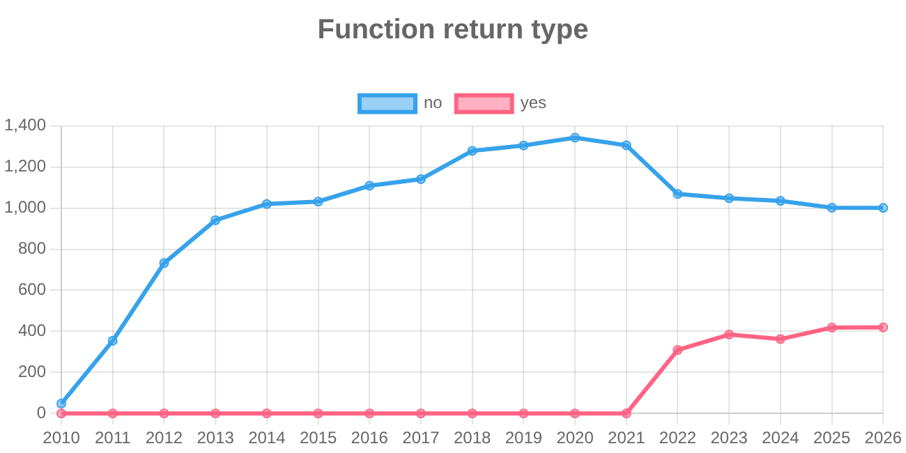

# Explorando evolução de código

Neste exercício, iremos explorar a evolução de código em sistemas reais.

Iremos utilizar a ferramenta [GitEvo](https://github.com/andrehora/gitevo).
Essa ferramenta analisa a evolução de código em repositórios Git nas linguagens Python, JavaScript, TypeScript e Java, e gera relatórios `HTML` como [este](https://andrehora.github.io/gitevo-examples/python/pandas.html).

Mais exemplos de relatórios podem ser podem ser encontrados em https://github.com/andrehora/gitevo-examples.

# Passo 1: Selecionar repositório a ser analisado

Selecione um repositório relevante na linguagem de sua preferência (Python, JavaScript, TypeScript ou Java).
Você pode encontrar projetos interessantes nos links abaixo:

- Python: https://github.com/topics/python?l=python
- JavaScript: https://github.com/topics/javascript?l=javascript
- TypeScript: https://github.com/topics/typescript?l=typescript
- Java: https://github.com/topics/java?l=java

# Passo 2: Instalar e rodar a ferramenta GitEvo

> [!NOTE]
> Antes de instalar a ferramenta, é recomendado criar e ativar um [ambiente virtual Python](https://packaging.python.org/en/latest/guides/installing-using-pip-and-virtual-environments/#create-and-use-virtual-environments).

Instale a ferramenta [GitEvo](https://github.com/andrehora/gitevo) com o comando:

```
$ pip install gitevo
```

Execute a ferramenta no repositório selecionado utilizando o comando abaixo (ajuste conforme a linguagem do repositório).
Substitua `<git_url>` pela URL do repositório que será analisado:

```shell
# Python
$ gitevo -r python <git_url>

# JavaScript
$ gitevo -r javascript <git_url>

# TypeScript
$ gitevo -r typescript <git_url>

# Java
$ gitevo -r java <git_url>
```

Por exemplo, para analisar o projeto Flask escrito em Python:

```
$ gitevo -r python https://github.com/pallets/flask
```

> [!NOTE]
> Essa etapa pode demorar alguns minutos pois o projeto será clonado e analisado localmente.

# Passo 3: Explorar o relatório de evolução de código

Após executar a ferramenta [GitEvo](https://github.com/andrehora/gitevo), é gerado um relatório `HTML` contendo diversos gráficos sobre a evolução do código.

Abra o relatório `HTML` e observe com atenção os gráficos.

# Passo 4: Explicar um gráfico de evolução de código

Selecione um dos gráficos de evolução e explique-o com suas palavras.
Por exemplo, você pode:

- Detalhar a evolução ao longo do tempo
- Detalhar se as curvas estão de acordo com boas práticas
- Explicar grandes alterações nas curvas
- Explorar a documentação do repositório em busca de explicações para grandes alterações
- etc.

Seja criativo!

# Instruções para o exercício

1. Crie um `fork` deste repositório (mais informações sobre forks [aqui](https://docs.github.com/pt/pull-requests/collaborating-with-pull-requests/working-with-forks/fork-a-repo)).
2. Adicione o relatório `HTML` no seu fork.
3. No Moodle, submeta apenas a URL do seu `fork`.

Responda às questões abaixo diretamente neste arquivo `README.md` do seu fork:

1. **Repositório selecionado:** [Flask — pallets/flask](https://github.com/pallets/flask)

2. **Gráfico selecionado:** `Function return type`, que mostra a quantidade de funções com e sem anotação explícita do tipo de retorno.

   

   [Relatório HTML completo](relatorios/flask.html) · [Dados em CSV](relatorios/flask.csv) · [Commits e evidências da análise](relatorios/evidencias.json)

   Para explorar os gráficos interativos, baixe o repositório e abra `relatorios/flask.html` em um navegador. O GitHub exibe o código do HTML; os gráficos usam Chart.js 4.4.7 carregado pela internet. A imagem acima pode ser consultada diretamente no README.

3. **Explicação:**

   O eixo horizontal representa os anos das amostras; o vertical, o número de definições de funções, incluindo métodos e funções internas. A curva `yes` conta definições com anotação de retorno, como `def exemplo() -> str:`, e `no` conta aquelas sem essa anotação. Portanto, `no` não significa ausência de uma instrução `return`: a métrica verifica a anotação na assinatura. O levantamento considera todos os arquivos `.py` presentes no commit, incluindo testes, exemplos e arquivos auxiliares.

   Até a amostra de 2021, todas as funções aparecem em `no`. O crescimento de 48 funções em 2010 para 1.343 em 2020 indica a expansão do código Python presente no repositório. Em 2021 há uma pequena queda para 1.306. A principal mudança ocorre entre os pontos de 2021 e 2022: surgem 309 funções com retorno anotado, enquanto as sem anotação diminuem para 1.069. Como o total cresce para 1.378, essa queda da curva `no` não representa uma redução equivalente na quantidade total de funções.

   | Amostra | Com anotação (`yes`) | Sem anotação (`no`) | Total de funções | Com anotação / total |
   | --- | ---: | ---: | ---: | ---: |
   | 2020 | 0 | 1.343 | 1.343 | 0,0% |
   | 2021 | 0 | 1.306 | 1.306 | 0,0% |
   | 2022 | 309 | 1.069 | 1.378 | 22,4% |
   | 2023 | 384 | 1.048 | 1.432 | 26,8% |
   | 2024 | 362 | 1.035 | 1.397 | 25,9% |
   | 2025 | 418 | 1.002 | 1.420 | 29,4% |
   | 2026 | 419 | 1.001 | 1.420 | 29,5% |

   Essa mudança tem uma explicação no histórico do Flask. O [changelog da versão 2.0.0, lançada em 11/05/2021](https://flask.palletsprojects.com/en/stable/changes/#version-2-0-0), registra a introdução de anotações de tipo. A alteração foi incorporada pelo [merge da PR #3973, em 27/04/2021](https://github.com/pallets/flask/commit/1a8549debb914eecc85cf63034093b55792c7e8f). Aplicando a mesma regra de contagem ao merge e ao seu primeiro pai, encontrei uma passagem de **0 para 303 funções com retorno anotado** em `src/flask`, mantendo o total desse diretório em 357 funções. Isso confirma que a adoção de anotações, por si só, pode fazer uma curva subir e a outra cair.

   A mudança aparece no ponto de **2022**, embora tenha ocorrido em **2021**, por causa da amostragem: nesta execução, o GitEvo selecionou o primeiro commit encontrado de cada ano. O ponto de 2021 corresponde a **01/01/2021**, anterior ao merge; o de 2022, a **13/01/2022**, posterior a ele. Assim, os pontos não representam o fechamento dos anos nem a soma de todas as alterações feitas em cada ano.

   Depois de 2022, a quantidade de funções anotadas cresce no conjunto do período, mas não de forma contínua: cai de 384 para 362 em 2024 e chega a 419 em 2026. A queda isolada não demonstra piora de qualidade, pois remoções e reorganizações também podem alterar as contagens. Sem examinar todas as mudanças desse intervalo, não atribuo essa queda a uma causa específica.

   Considero a adoção de anotações coerente com boas práticas de manutenção: elas tornam o contrato das funções mais explícito e permitem verificações estáticas. O próprio merge acrescentou configuração do mypy para `src/flask`. Entretanto, contar anotações não mede sua precisão, a cobertura dos testes ou a quantidade de defeitos; também não transforma Python em uma linguagem que valida esses tipos automaticamente em execução.

   Uma observação importante é que os **29,5% do repositório inteiro** escondem diferenças entre diretórios. No commit amostrado de 2026, `src/flask` contém **366 funções anotadas de 369 (99,2%)**, enquanto `tests` contém **42 de 988 (4,3%)**. Os demais arquivos somam 11 anotadas e 52 sem anotação. Portanto, a predominância da curva `no` no gráfico agregado não significa que a biblioteca principal tenha pouca adoção de anotações de retorno. As contagens por diretório estão registradas nas evidências.

## Execução e reprodução

A análise foi executada em **06/11/2026**, no ambiente Conda **`eng`**, com **Python 3.14.0** e **GitEvo 0.1.3**, usando as métricas padrão do relatório Python. Foram coletadas **17 amostras anuais, de 2010 a 2026**, a partir do histórico alcançável pelo commit [`49943b5a94413a530761350f04e896f76e8d620e`](https://github.com/pallets/flask/commit/49943b5a94413a530761350f04e896f76e8d620e). A última amostra é de **05/01/2026**, não do dia da execução. O arquivo de evidências identifica a data e o hash de cada amostra.

O comando da etapa 2 foi executado com os limites explícitos `-f 2010 -t 2026`. O script abaixo usa a mesma API e as mesmas métricas do GitEvo para gerar os arquivos em `relatorios/` e registrar as verificações adicionais. O clone do Flask fica fora deste repositório.

```bash
conda activate eng
"$CONDA_PREFIX/bin/python" -m pip install -r requirements.txt
git clone https://github.com/pallets/flask.git /tmp/flask-gitevo
git -C /tmp/flask-gitevo checkout --detach 49943b5a94413a530761350f04e896f76e8d620e
"$CONDA_PREFIX/bin/python" scripts/analisar_flask.py /tmp/flask-gitevo
```

Para reproduzir a captura do gráfico diretamente do HTML:

```bash
export PLAYWRIGHT_BROWSERS_PATH=/tmp/exploring-code-evolution-browsers
"$CONDA_PREFIX/bin/python" -m playwright install chromium --only-shell
"$CONDA_PREFIX/bin/python" scripts/capturar_grafico.py
```

Os comandos usam o interpretador indicado por `CONDA_PREFIX` para evitar que outro ambiente virtual presente no `PATH` seja usado por engano. A captura requer acesso à internet para carregar o Chart.js e um sistema com as bibliotecas necessárias ao Chromium.


